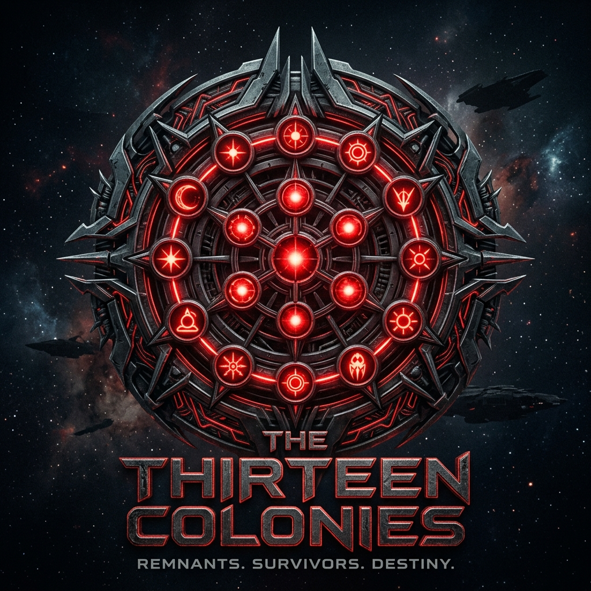

<div align="center">
  
  <h1>Cylon Images</h1>
  <p><em>By your command.</em></p>
</div>

This repository builds Docker-composed guest artifacts. The primary output is
an OCI-distributed native KVM bundle consumed directly by Aether.

| Directory | Target | Output |
|---|---|---|
| [`container/kvm/`](container/kvm/) | Aether native QEMU/KVM guest | `image.json`, qcow2, kernel and initramfs → GHCR |
| [`container/rootfs/`](container/rootfs/) | Dockerfile guest composition | OCI rootfs with compatible `cylon-skills` |
| [`container/kernel/`](container/kernel/) | Legacy Firecracker compatibility | `vmlinux` → GHCR |
| [`multipass/`](multipass/) | **Retired** development host path | Historical cleanup material only |
| [`multipass-gha-runner/`](multipass-gha-runner/) | ~~Org GHA runner~~ **DEPRECATED** | Use ARC in `shared-gitops-k8s-cluster` (`docs/gha-arc.md`) |

> **Kernel note:** Firecracker guest configs — [firecracker guest_configs](https://github.com/firecracker-microvm/firecracker/tree/main/resources/guest_configs)

## Quick start

```bash
# Repo root — all recipes via import
just --list

# Native KVM artifact (rootfs build needs sibling ../cylon-skills)
just kvm-build dev
just kvm-verify dev
```

Multipass is not a supported development or production path. Its old recipes
are no longer imported by the repository root and creation commands fail
closed if invoked directly.

## CI

| Workflow | Path filter | Publishes |
|---|---|---|
| [`kernel.yml`](.github/workflows/kernel.yml) | `container/kernel/**` | `ghcr.io/.../cylon-kernel:6.1.102` |
| [`rootfs.yml`](.github/workflows/rootfs.yml) | `container/rootfs/**` | `ghcr.io/.../cylon-rootfs-ubuntu:latest` |
| [`kvm-image.yml`](.github/workflows/kvm-image.yml) | `container/kvm/**`, `container/rootfs/ubuntu/**` | `ghcr.io/.../aether-kvm-ubuntu:<sha>` and `latest` |

Rootfs CI checks out `microscaler/cylon-skills` into `container/rootfs/ubuntu/cylon-skills-registry` before `docker build`.

## The Thirteen Personalities

> *There are many copies. And they have a plan.*

The full Ubuntu rootfs (`container/rootfs/ubuntu/`) bakes the cylon-skills registry for 13 operational identities. See [`container/rootfs/ubuntu/Dockerfile`](container/rootfs/ubuntu/Dockerfile).
